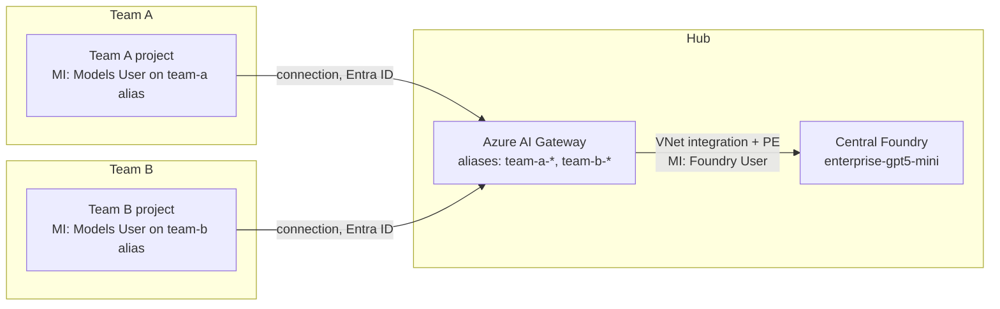

# Azure AI Gateway for Microsoft Foundry

This document explains how the repository governs model access with the standalone
**Azure AI Gateway** (`Microsoft.ApiManagement/aigateways`, API `2026-11-01`). Everything
on the routing path — gateway, model provider, per-team aliases and policies, alias-scoped
RBAC, and the team project connections — is deployed by Bicep. There are no API keys,
policy XML files, or post-deploy portal steps.

> **Preview.** Azure AI Gateway is in public preview with **no SLA**. The Bicep type index
> does not list `2026-11-01` yet, so the modules suppress `BCP081`, as the official
> samples do. See the [AI gateway documentation](https://learn.microsoft.com/azure/api-management/)
> and the [Azure/ai-gateway samples](https://github.com/Azure/ai-gateway).

## How it works

1. **One gateway in the hub.** `aigw-<prefix>-<suffix>-<unique>` (max 24 characters) is
   deployed in the hub resource group (`infra/modules/ai-gateway.bicep`) with a
   system-assigned managed identity. Outbound **VNet integration** places it in
   `snet-aigw-integration`, so its calls to central Foundry use the central private
   endpoint and the hub's private DNS zones.

2. **The gateway is the only caller of the central model.** Its identity holds
   **Foundry User** on the central Foundry account (`infra/modules/rbac-central.bicep`).
   Teams get no role there.

3. **The central deployment is published once.** `infra/modules/ai-gateway-models.bicep`
   creates a Foundry model provider (`foundry-central`, managed-identity auth) and a
   model registration for the central deployment that supports
   `/openai/v1/chat/completions` and `/openai/v1/responses`.

4. **Each team gets its own alias.** The alias name is `<team>-<deploymentName>`, for
   example `team-a-enterprise-gpt5-mini`. Each alias carries:
   - a `tokenLimit` policy (tokens per minute from `teamTokenLimitsPerMinute`,
     `counterKey: identity`), and
   - an optional `contentSafety` policy (`enableContentSafetyPolicy`, off by default
     because the policy is still aligning with API `2026-11-01`).

5. **Team isolation is alias-scoped RBAC.** `infra/modules/ai-gateway-alias-role.bicep`
   grants **AI Gateway Models User** on **one alias**. Each team project's managed
   identity gets its own alias only, so a call to another team's alias returns
   `401`/`403`. Raw deployment names and unpublished models are not routed.

6. **Team projects consume the alias through a connection.**
   `infra/modules/foundry-model-connection.bicep` creates the same connection that the
   Foundry portal's "Add consuming project" creates:

   | Property | Value |
   | --- | --- |
   | Name | `<gateway>-model-gateway` |
   | Category | `ApiManagement` (metadata `apimResourceKind: AiGateway`) |
   | Auth | `ProjectManagedIdentity`, audience `https://azure-api.net/aigateway` |
   | Target | `<gatewayUrl>/default/models/openai/v1` |
   | Models | the team alias (static list) |
   | Upstream | `upstreamSurface: responses` when `useResponsesApiUpstream=true` |

   Foundry shows the model as `<connection>/<alias>`
   (outputs `teamAFoundryModel` / `teamBFoundryModel`).

7. **Ingress is public, Entra ID only.** The gateway endpoint is public; no API keys are
   created. AI Gateway API keys (`aigateways/apiKeys`) are gateway-wide rather than
   per team, so they would break team isolation and are intentionally unused. An inbound
   private endpoint is optional (`deployAiGatewayPrivateEndpoint`, see
   [Caveats](#caveats)).

## Calling the gateway

```text
POST https://<gateway-host>/default/models/openai/v1/chat/completions
POST https://<gateway-host>/default/models/openai/v1/responses
Authorization: Bearer <Entra token for https://ai.gateway.azure.com>

{ "model": "team-a-enterprise-gpt5-mini", ... }
```

`https://azure-api.net/aigateway` is also accepted as the token audience. No
`api-version` is needed. For an OpenAI client, set `base_url` to the
`aiGatewayModelsEndpoint` output and pass the Entra token as the API key / bearer token.

```bash
TOKEN=$(az account get-access-token --resource https://ai.gateway.azure.com --query accessToken -o tsv)
curl -sS "$(az deployment sub show -n enterprise-foundry --query properties.outputs.aiGatewayModelsEndpoint.value -o tsv)/responses" \
  -H "Authorization: Bearer $TOKEN" -H 'Content-Type: application/json' \
  -d '{"model":"team-a-enterprise-gpt5-mini","input":"hello","max_output_tokens":64}'
```

Through a team Foundry project, call `<project-endpoint>/openai/v1/responses` with an
Entra token for `https://ai.azure.com` and `"model": "<connection>/<alias>"`.

## Architecture



## Related parameters

| Parameter | Purpose | Default |
| --- | --- | --- |
| `teamTokenLimitsPerMinute` | Per-team TPM on each alias (aligned with `teamNames`) | `[1000, 1000]` |
| `enableTokenLimitPolicy` | Apply the `tokenLimit` policy | `true` |
| `enableContentSafetyPolicy` | Apply a `contentSafety` policy (Medium, all categories) | `false` |
| `useResponsesApiUpstream` | Project connections send Responses API requests (false = Chat Completions) | `true` |
| `deployAiGatewayPrivateEndpoint` | Inbound private endpoint + DNS zone (gated feature) | `false` |
| `gatewayTestPrincipalId` / `gatewayTestPrincipalType` | Test identity: Models User on the first team alias + Foundry User on that team's account | `''` / `User` |
| `networkAccessMode` | Data-plane posture (`hybridPePlusIp` \| `publicIpOnly` \| `privateOnly`) | `hybridPePlusIp` |

## Tests

`./scripts/test-model-through-gateway.sh` runs all of these:

| Script | Asserts |
| --- | --- |
| `scripts/test-gateway-health.sh` | Unauthenticated call → `401`/`403` |
| `scripts/test-gateway-inference.sh` | Team A alias, Chat Completions and Responses → `200` |
| `scripts/test-team-isolation.sh` | Team B alias → `401`/`403`; raw deployment name / unpublished model → `4xx` |
| `scripts/test-foundry-project-through-gateway.sh` | Team A project, `<connection>/<alias>` via Responses → `200` |
| `scripts/test-direct-central-foundry-blocked.sh` | Direct central Foundry call → `401`/`403` or `000` |

`deploy.sh` passes the signed-in identity as `gatewayTestPrincipalId` (set
`SKIP_TEST_PRINCIPAL=1` to skip). Positive checks retry on `401`/`403`
(`RETRY_ATTEMPTS`, `RETRY_DELAY`) while new role assignments propagate.

## Caveats

- **Preview, no SLA.** Resource shapes and policies may change.
- **Foundry portal reachability is separate from gateway access.** The operator IP
  allowlist covers Foundry and connected data endpoints, not gateway ingress.
  `scripts/test-demo-access.sh` checks the current shell's network path; see
  [`demo-access.md`](demo-access.md) for live-demo preparation and policy-exemption
  limits.
- **Inbound private endpoint is gated.** It needs the subscription feature
  `Microsoft.Network/AllowPrivateEndpoints`; without it, creation fails with
  `SubscriptionNotRegisteredForFeature`. When enabled, the module creates a
  `Gateway` private endpoint and a zone named after the host minus its first label
  (for example `privatelink.swedencentral-01.ai.gateway.azure.com`), linked to the hub
  and both spokes.
- **Telemetry is manual.** The AI Gateway OpenTelemetry exporter
  (`workspaces/telemetryExporters`) needs Application Insights OTLP ingestion and
  Monitoring Metrics Publisher on a managed data collection rule, so it is a post-deploy
  step. There are no gateway diagnostic settings or token metrics in Log Analytics.
- **Token limits are per caller identity per alias.** Every identity that calls a team
  alias gets that team's full budget; with one project identity per team this equals a
  per-team budget.
- **`publicIpOnly` breaks gateway egress.** That mode has no central private endpoint,
  so the gateway (egressing from its VNet integration) is blocked by central Foundry's IP
  allowlist. Use `hybridPePlusIp` or `privateOnly`.
- **Agent runtimes in spokes** need outbound access to the gateway's public endpoint
  (not verified in this sandbox).
- **Foundry → AI Gateway connections** are an emerging capability; the connection
  metadata mirrors what the portal creates today.
