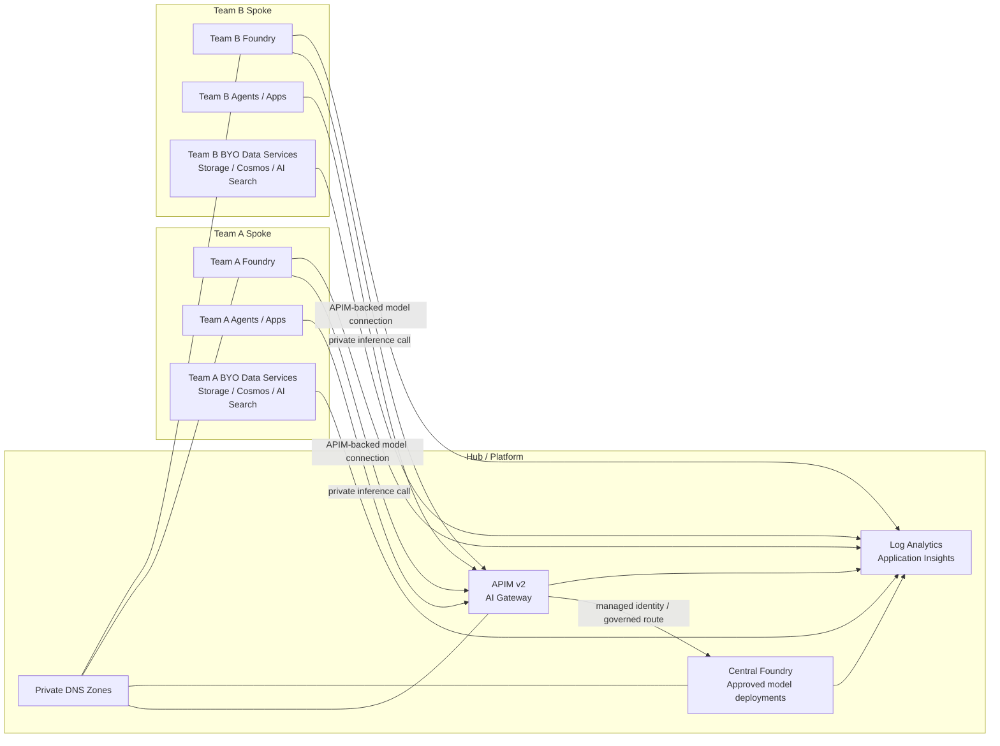

# Architecture

This repository deploys an **enterprise-shaped Microsoft Foundry simulation** on Azure
using Bicep. It models a hub/spoke topology with central model governance and team
isolation, where teams consume approved models **only** through a central APIM AI Gateway.

## Diagram



## Components

### Central Foundry (hub)
A `Microsoft.CognitiveServices/accounts` resource of kind `AIServices` with project
management enabled. It hosts the approved model deployment (`enterprise-gpt5-mini`).
It is the **only** place approved models are deployed, giving the platform team a single
control point for model governance, capacity, and cost.

### Team Foundries (spokes)
Each team gets its own `AIServices` account and project plus BYO data resources
(Storage, Cosmos DB, AI Search, Key Vault). Teams build agents/apps here but do **not**
deploy their own frontier models — they call the central model via the gateway.

By default each team account is a **VNet-injected standard agent**
(`enableAgentNetworkInjection = true`): the account is injected into the spoke's dedicated
agent subnet, and the team's BYO data is wired into the project as standard-agent
connections — Cosmos DB (thread store), Storage (file store), and AI Search (vector store),
all AAD-auth — together with a project **capability host**. The project managed identity is
granted the data-plane roles plus the control-plane **Cosmos DB Operator** role the
capability host requires (`infra/modules/foundry-team-agent.bicep`).

### APIM v2 AI Gateway (hub)
The shared AI traffic control plane. It can be **deployed** (Standard v2 by default) or you
can **bring your own** existing v2 APIM (`existingApimResourceId`). The gateway is
provisioned **first**, then the central and team Foundries connect to it (gateway-first
ordering). It exposes stable enterprise model aliases per team, routes them to the central
deployment using its **managed identity** (no keys), and enforces token limits, token
metrics, logging, and optional content safety. An optional account-level native AI Gateway
association (`scripts/enable-ai-gateway.sh`) adds control-plane visibility and project
auto-enroll on top.

Routes:

```
POST /ai/team-a/models/enterprise-fast/chat/completions
POST /ai/team-a/models/enterprise-reasoning/chat/completions
POST /ai/team-b/models/enterprise-fast/chat/completions
POST /ai/team-b/models/enterprise-reasoning/chat/completions
```

### Observability (hub-adjacent)
A Log Analytics Workspace + Application Insights. Every supported resource sends
diagnostic settings here; APIM also logs to Application Insights.

## Why these choices

- **APIM lives in the hub** because it is the shared AI traffic control plane that all
  teams depend on; centralizing it gives one governance, throttling, and metering point.
- **Team Foundries live in spokes** because they represent team-owned build environments
  that must be isolated from one another while still reaching shared platform services
  over private peering.
- **APIM v2 (Standard v2 by default)** is selected because it supports the AI Gateway
  policies (token limit, token metrics, content safety), outbound VNet integration, and
  inbound private endpoints at a lower cost than Premium, without classic-VNet complexity.
  A v2 tier is also required by the native AI Gateway association. Bring-your-own APIM is
  supported as long as it is a v2 tier (Consumption/serverless is not).

## Intentional exclusions

- **No PTU** — provisioned throughput is expensive and unnecessary for a simulation;
  capacity is minimal Standard.
- **No Azure Firewall / forced tunneling** — would add cost and operational weight beyond
  the goal of demonstrating Foundry interconnection and gateway governance.
- **No customer-managed keys (CMK)** — platform-managed keys are sufficient here and avoid
  Key Vault key lifecycle overhead.
- **No availability zones** — single-region, non-HA simulation by design.

## Trust boundaries

- **Team ⟷ Team**: enforced by separate spokes, separate identities, separate APIM
  products/subscriptions, and no cross-team RBAC. Team A cannot call Team B's route and
  cannot read Team B's data.
- **Team ⟷ Central model**: teams have no data-plane role on the central account and (with
  private networking) no network path to it. The APIM managed identity is the only
  sanctioned caller.

## Data / control-plane flows

1. A team app calls its APIM route with its team subscription key (private gateway).
2. APIM validates the subscription scope, maps the alias to the central deployment, and
   authenticates to the central Foundry with its managed identity.
3. APIM forwards the request to the central model endpoint and returns the response.
4. Token usage, latency, status, and request metadata flow to Application Insights /
   Log Analytics. Prompt/response bodies are not logged unless explicitly enabled.
