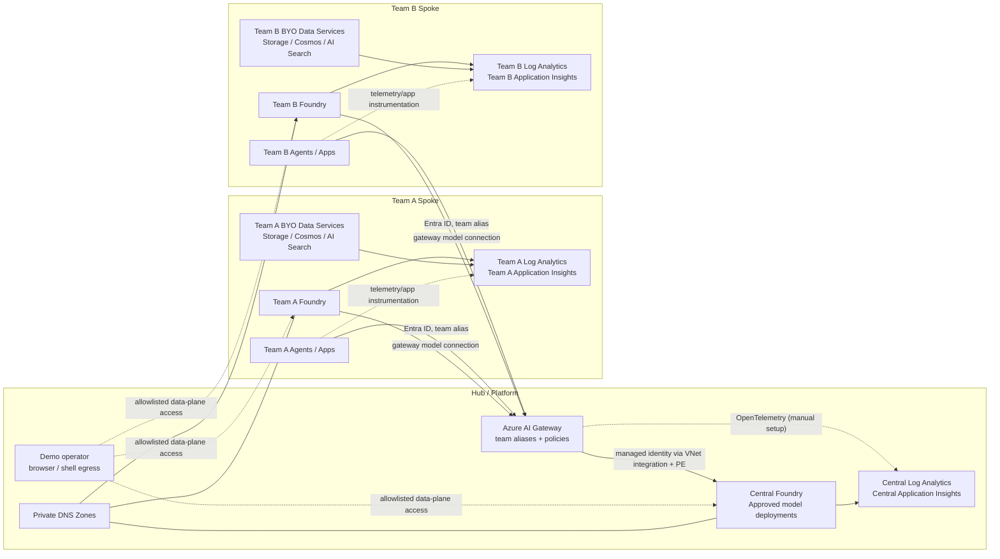

# Architecture

This repository deploys an **enterprise-shaped Microsoft Foundry simulation** on Azure
using Bicep. It models a hub/spoke topology with central model governance and team
isolation, where teams consume approved models **only** through a central **Azure AI
Gateway** (`Microsoft.ApiManagement/aigateways`, API `2026-11-01`, public preview, no SLA).

## Diagram



## Components

### Central Foundry (hub)
A `Microsoft.CognitiveServices/accounts` resource of kind `AIServices` with project
management enabled. It hosts the approved model deployment (`enterprise-gpt5-mini`).
It is the **only** place approved models are deployed, giving the platform team a single
control point for model governance, capacity, and cost.

### Team Foundries (spokes)
Each team gets its own `AIServices` account and project plus BYO data resources
(Storage, Cosmos DB, AI Search, Key Vault). Teams build agents/apps here but do **not**
deploy their own frontier models — they call the central model via the gateway.

By default each team account is a **VNet-injected standard agent**
(`enableAgentNetworkInjection = true`): the account is injected into the spoke's dedicated
agent subnet, and the team's BYO data is wired into the project as standard-agent
connections — Cosmos DB (thread store), Storage (file store), and AI Search (vector store),
all AAD-auth — together with a project **capability host**. The project managed identity is
granted the data-plane roles plus the control-plane **Cosmos DB Operator** role the
capability host requires (`infra/modules/foundry-team-agent.bicep`).

### Azure AI Gateway (hub)
The shared AI traffic control plane (`infra/modules/ai-gateway.bicep`), named
`aigw-<prefix>-<suffix>-<unique>` (max 24 characters). It has a system-assigned managed
identity holding **Foundry User** on the central account, and outbound **VNet
integration** into the hub subnet `snet-aigw-integration` (delegated to
`Microsoft.App/environments`, NSG without custom rules), so backend calls reach central
Foundry through its private endpoint and the hub's private DNS zones.

`infra/modules/ai-gateway-models.bicep` publishes the central deployment as a Foundry
model provider (`foundry-central`, managed-identity auth) plus one **alias per team**,
`<team>-<deploymentName>` (for example `team-a-enterprise-gpt5-mini`). Each alias has a
`tokenLimit` policy and an optional `contentSafety` policy. Each team project identity
gets **AI Gateway Models User** on its own alias only, and each team project has a
gateway model connection (`<gateway>-model-gateway`) exposing `<connection>/<alias>`.

Ingress is public and Entra-ID only (no API keys); an inbound private endpoint is
optional (`deployAiGatewayPrivateEndpoint`, gated feature). Runtime endpoint:

```
POST https://<gateway-host>/default/models/openai/v1/chat/completions   {"model": "team-a-enterprise-gpt5-mini", ...}
POST https://<gateway-host>/default/models/openai/v1/responses          {"model": "team-b-enterprise-gpt5-mini", ...}
```

See [`ai-gateway.md`](ai-gateway.md) for details and caveats.

### Observability
The hub has a central Log Analytics Workspace + Application Insights; the central
Foundry sends diagnostics to it. The AI Gateway has no diagnostic settings; its
OpenTelemetry exporter is a manual post-deploy step (see `implementation-gaps.md`). Each team spoke also has its own Log Analytics Workspace + Application
Insights, and that team's Foundry account plus BYO data resources send diagnostics to it.
Team-built agents/apps can point at the team-local Application Insights instance.

### Operator access for live demos
In the default `hybridPePlusIp` mode, the public data-plane endpoints are deny-by-default
and allow the operator's detected egress ranges. The dev parameter file also opts
Storage, Cosmos DB, and Key Vault out of the tenant policy that otherwise forces
`publicNetworkAccess=Disabled`; that exception is limited to these data resources and
should be reviewed before use outside a demo environment. `deploy.sh` runs the
reachability check automatically. Run `scripts/allow-demo-access.sh` when the operator
moves networks. The check validates network reachability, not portal identity or data
authorization. See [`demo-access.md`](demo-access.md).

## Why these choices

- **The AI Gateway lives in the hub** because it is the shared AI traffic control plane that all
  teams depend on; centralizing it gives one governance, throttling, and metering point.
- **Team Foundries live in spokes** because they represent team-owned build environments
  that must be isolated from one another while still reaching shared platform services
  over private peering.
- **Azure AI Gateway instead of API Management** because it is purpose-built for model
  traffic: model providers, aliases, token-limit and content-safety policies, and
  alias-scoped Entra RBAC are declarative resources, with no policy XML, products, or
  subscription keys. It also supports outbound VNet integration and an inbound private
  endpoint. The trade-off is preview status (no SLA) and less mature telemetry.

## Intentional exclusions

- **No PTU** — provisioned throughput is expensive and unnecessary for a simulation;
  capacity is minimal Standard.
- **No Azure Firewall / forced tunneling** — would add cost and operational weight beyond
  the goal of demonstrating Foundry interconnection and gateway governance.
- **No customer-managed keys (CMK)** — platform-managed keys are sufficient here and avoid
  Key Vault key lifecycle overhead.
- **No availability zones** — single-region, non-HA simulation by design.

## Trust boundaries

- **Team ⟷ Team**: enforced by separate spokes, separate identities, separate gateway
  aliases with alias-scoped RBAC, and no cross-team RBAC. Team A cannot call Team B's alias
  and cannot read Team B's data.
- **Team ⟷ Central model**: teams have no data-plane role on the central account and (with
  private networking) no network path to it. The AI Gateway managed identity is the only
  sanctioned caller.

## Data / control-plane flows

1. A team app (or the team project, through its connection) calls the gateway with an
   Entra token and its team alias in the `model` field.
2. The gateway checks that the caller holds AI Gateway Models User on that alias and
   applies the alias's token limit (and content safety, if enabled).
3. The gateway calls the central Foundry deployment with its managed identity over the
   hub VNet integration and private endpoint, and returns the response.
4. Gateway telemetry is available only after configuring its OpenTelemetry exporter;
   central and team Foundry diagnostics flow to Log Analytics.
