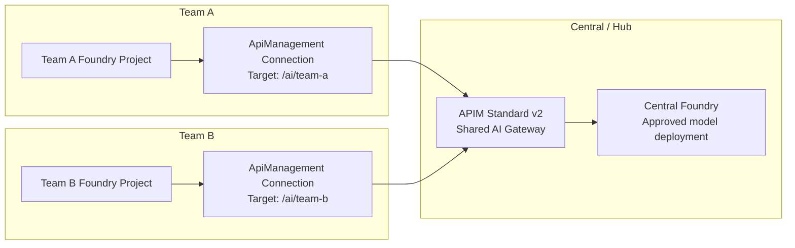

# Bring-Your-Own APIM AI Gateway for Microsoft Foundry

This document explains the **scriptable** Bring-Your-Own (BYO) Azure API Management
(APIM) AI Gateway pattern used in this repository. The functional model-routing path
is implemented entirely in Bicep and Azure CLI and does **not** depend on the Foundry
portal's resource-level "Enable AI Gateway" button. That portal association is offered
separately as an **optional** add-on (`scripts/enable-ai-gateway.sh`, see point 6).

You can either let the template **deploy** the gateway (APIM Standard v2 by default) or
**bring your own** existing APIM by setting `existingApimResourceId`. In both cases the
instance must be a **v2 tier** — Consumption/serverless APIM is not supported by the
native AI Gateway. When you BYO, the template references your APIM in place and still
authors the per-team Products / APIs / subscriptions onto it; it does not recreate the
service.

## How it works

1. **APIM is the actual shared AI Gateway.** A single APIM v2 instance (deployed
   `apim-ai-gw-swc-dev`, or your BYO instance) in the hub is the one and only gateway.
   All inference traffic from every team flows through it; teams never call the model
   directly. It comes up **first**, then the Foundry accounts connect to it.

2. **The Foundry-side part is a project connection with `category = ApiManagement`.**
   Each team Foundry *project* gets an admin-created connection
   (`Microsoft.CognitiveServices/accounts/projects/connections`) whose category is
   `ApiManagement`. This is what makes the gateway-backed model appear inside the
   team's Foundry project. It is created in Bicep
   (`infra/modules/foundry-model-connection.bicep`).

3. **All teams connect to the same APIM instance.** Both Team A and Team B
   connections target the same gateway host. Only the path prefix differs
   (`/ai/team-a` vs `/ai/team-b`), so there is a single shared gateway, not one
   per team.

4. **Team separation is done by APIM API path / product / subscription.** Each team
   has its own API (distinct path prefix), its own Product, and its own
   Subscription key. A team's key is only valid on that team's API. Cross-team
   calls return `401`/`403`. (Entra-ID JWT validation is the preferred production
   alternative and is documented in `docs/security-decisions.md`.)

5. **Model sharing is done by APIM routing to the same central Foundry deployment.**
   Every team API's inbound policy rewrites the backend to the central Foundry
   endpoint and the single approved deployment (`enterprise-gpt5-mini`). Teams
   share one governed model without any of them owning it.

6. **The portal "Enable AI Gateway" association is offered as an optional add-on.**
   The portal feature associates one APIM (v2 tier) with one Foundry resource for
   per-project token governance and control-plane visibility. Because that shape is
   one-to-one, it cannot by itself express our hub/spoke topology (one APIM governing
   three separate Foundry resources), so the **functional** routing path does not rely
   on it. For teams that want the control-plane object as well, `scripts/enable-ai-gateway.sh`
   associates the gateway with the **central** Foundry account idempotently (and
   auto-enrolls its projects), falling back to the documented Admin-console steps where
   the preview API is unavailable. See `docs/implementation-gaps.md` (gap 7).

7. **We avoid scripting brittle, undocumented behavior as a hard dependency.** The
   account-level association is a control-plane preview without a stable Bicep/ARM type,
   so it is kept as an optional, idempotent post-deploy step rather than a deployment
   prerequisite. The supported APIM resources and project connections remain the
   source of truth for routing.

8. **The first implementation uses static model discovery.** The connection carries
   a static `metadata.models` list naming `enterprise-gpt5-mini`, so the deployment
   surfaces in the team project without a live discovery call.

9. **Dynamic model discovery can be added later.** If the gateway later exposes a
   `/deployments` listing operation (or the platform adds discovery for
   `ApiManagement` connections), the static list can be replaced with live
   enumeration.

10. **Managed identity is preferred for APIM-to-Foundry backend authentication.**
    The gateway authenticates to the central Foundry backend using the APIM
    instance's system-assigned managed identity (`authentication-managed-identity`
    in the policy), with a `Cognitive Services User` role assignment. No model key
    is stored in APIM.

11. **API-key based Team-Foundry-to-APIM connection is acceptable for simulation.**
    The team project connection currently uses `authType = ApiKey` (the team's APIM
    subscription key, sent as the `api-key` header) because the APIM team Products
    require a subscription key. `ProjectManagedIdentity` is exposed as a parameter
    (`foundryToApimAuthType`) for future use, but it only works once APIM is
    configured to accept Entra tokens from the project identity instead of
    subscription keys.

## Route shape

Teams call a clean, deployment-in-path route (no `/openai` segment):

```text
POST https://<apim-host>/ai/team-a/deployments/enterprise-gpt5-mini/chat/completions?api-version=<version>
POST https://<apim-host>/ai/team-b/deployments/enterprise-gpt5-mini/chat/completions?api-version=<version>
```

The gateway policy:

- enforces the configured `api-version`,
- returns `403` if the requested deployment is not the approved central deployment,
- rewrites the backend to `<central-foundry>/openai`,
- attaches the APIM managed identity token,
- strips inbound `api-key` / `Ocp-Apim-Subscription-Key` from the backend call,
- applies a per-team token-per-minute limit and emits per-team token metrics.

## Architecture



## Related parameters

| Parameter | Purpose | Default |
| --- | --- | --- |
| `existingApimResourceId` | BYO: reference an existing **v2** APIM instead of deploying one (empty = deploy) | `''` |
| `apimSkuName` | SKU when deploying a new gateway; must be a v2 tier (`BasicV2` \| `StandardV2` \| `PremiumV2`) | `StandardV2` |
| `networkAccessMode` | Data-plane posture (`hybridPePlusIp` \| `publicIpOnly` \| `privateOnly`) | `hybridPePlusIp` |
| `allowedClientIp` | Operator IP allowlisted on the data plane (deploy script auto-detects) | `''` |
| `enableAgentNetworkInjection` | VNet-inject the team agent runtime + wire BYO data connections | `true` |
| `deployAgentCapabilityHost` | Create each project's standard-agent capability host | `true` |
| `foundryToApimAuthType` | Team project → APIM connection auth (`ApiKey` \| `ProjectManagedIdentity`) | `ApiKey` |
| `inferenceApiVersion` | API version enforced by the gateway and used by connections | `2024-10-21` |
| `teamTokenLimitsPerMinute` | Per-team TPM limit (aligned by index with `teamNames`) | `[1000, 1000]` |
| `enableTokenLimitPolicy` | Apply the per-team token-limit policy | `true` |
| `enableTokenMetricPolicy` | Emit per-team token metrics | `true` |
| `enablePromptBodyLogging` | Log prompt/completion bodies (off by default) | `false` |
| `enableContentSafetyPolicy` | Apply a content-safety fragment in the policy | `false` |

## Tests

| Script | Asserts |
| --- | --- |
| `scripts/test-team-a-through-apim.sh` | Team A key on Team A route → `200` |
| `scripts/test-team-b-through-apim.sh` | Team B key on Team B route → `200` |
| `scripts/test-team-isolation.sh` | Cross-team key → `401`/`403` |
| `scripts/test-direct-central-foundry-blocked.sh` | Direct central Foundry call → blocked |

Because the team-isolation and direct-blocked behaviors rely on network posture, the
exact result depends on `networkAccessMode`. In the default `hybridPePlusIp` mode the
central Foundry account's public access is **Enabled but locked to the operator IP**, so a
direct call from a non-allowlisted client is refused; from outside the VNet entirely it
returns `000` (unreachable), which is the expected "blocked" result. The APIM gateway is
publicly reachable (subscription-key gated, intentionally not IP-filtered), so the
through-APIM tests succeed from any client with a valid team key.
