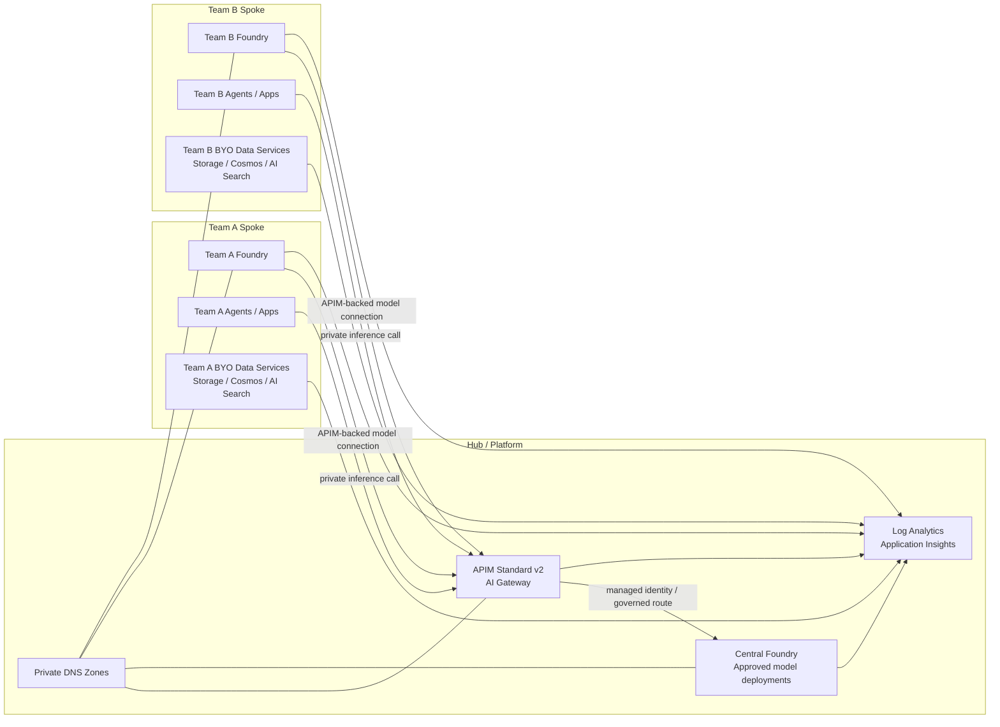

# Historical implementation brief (superseded)

This file records the original project brief and is retained for traceability; it is
**not** the current architecture or deployment specification. Its API Management (APIM)
requirements were superseded when the implementation moved to the standalone Azure AI
Gateway (`Microsoft.ApiManagement/aigateways`) and added operator network access checks
for Foundry live demos. Do not follow the APIM-specific requirements below for new work.

Use the current documentation instead:

- [README](README.md) for the current system and quick start.
- [Architecture](docs/architecture.md) and [Azure AI Gateway](docs/ai-gateway.md) for
  topology and model routing.
- [Deployment](docs/deployment.md) and [live-demo access](docs/demo-access.md) for
  deployment, network reachability, and policy exemptions.
- [Security decisions](docs/security-decisions.md) for trust boundaries and controls.

---

You are GitHub Copilot Agent running in VS Code with terminal access to an empty repository. Build a production-style Azure simulation using Bicep.

# Goal

Create a complete Bicep-based Azure deployment that simulates an enterprise Microsoft Foundry topology with:

* One CENTRAL Foundry resource in a hub/platform area.
* Two TEAM Foundry resources in separate spoke areas: Team A and Team B.
* A CENTRAL Azure API Management AI Gateway in the hub.
* Central Foundry owns/hosts approved model deployments.
* Team Foundries and team apps consume models only through APIM.
* BYO resources for each Team Foundry: VNet, Storage, Cosmos DB, Azure AI Search, Key Vault where needed.
* Private networking and private DNS where practical.
* Full diagnostic settings into Log Analytics.
* Region: Sweden Central.
* IaC: Bicep.
* APIM SKU: Standard v2.
* No availability zones.
* No PTU.
* No Azure Firewall.
* No CMK.
* No overly elaborate enterprise extras. Keep the focus on Foundry interconnection, APIM as AI Gateway, team isolation, and diagnostics.

This is not a toy demo, but also not the most expensive production topology. It should be “enterprise-shaped”: hub/spoke, central governance, team isolation, managed identities, diagnostics, policy-like structure, deterministic names, and validation scripts.

# Critical instruction

Do not hallucinate Azure resource types, API versions, or unsupported Bicep properties.

Before implementing each resource type, verify the current Bicep shape using one or more of:

* Azure Verified Modules if available.
* Current Microsoft Learn examples.
* `az provider show`
* `az bicep build`
* `az deployment sub validate`
* `az deployment group validate`
* `az deployment group what-if`

If the exact current resource type for a Microsoft Foundry feature cannot be deployed reliably with Bicep, do not fake it. Instead:

1. Implement all supported resources around it.
2. Create an explicit `docs/implementation-gaps.md`.
3. Add an idempotent Azure CLI script under `scripts/` for the missing step, if supported by CLI.
4. Add a TODO with exact manual portal steps only as a last resort.
5. Keep the rest of the deployment compiling.

The final repository must compile with `az bicep build`.

# High-level architecture

Use this logical architecture:

```text
Subscription or single simulation subscription
│
├── rg-ai-observability-swc-001
│   ├── Log Analytics Workspace
│   └── Application Insights
│
├── rg-ai-hub-swc-001
│   ├── Hub VNet
│   ├── APIM Standard v2 AI Gateway
│   ├── Central Foundry resource
│   ├── Central model deployment(s)
│   ├── Hub Key Vault, if needed
│   ├── Private endpoints
│   └── Private DNS zones linked to hub/spokes
│
├── rg-ai-team-a-swc-001
│   ├── Team A Spoke VNet
│   ├── Team A Foundry resource
│   ├── Team A Foundry project
│   ├── Team A Storage Account
│   ├── Team A Cosmos DB account
│   ├── Team A Azure AI Search
│   ├── Team A Key Vault, if needed
│   ├── Private endpoints
│   └── Optional small test workload / test script identity
│
└── rg-ai-team-b-swc-001
    ├── Team B Spoke VNet
    ├── Team B Foundry resource
    ├── Team B Foundry project
    ├── Team B Storage Account
    ├── Team B Cosmos DB account
    ├── Team B Azure AI Search
    ├── Team B Key Vault, if needed
    ├── Private endpoints
    └── Optional small test workload / test script identity
```

Central APIM should sit in the hub because it is the shared AI traffic control plane. Team Foundries sit in spokes because they represent team-owned build environments. Central Foundry holds approved model deployments. Teams should not directly call Central Foundry model endpoints in the intended flow; they should call APIM routes.

# Resource naming

Use deterministic, parameterized naming. Use short names because Storage and other Azure resources have length limits.

Default environment: `dev`
Default location: `swedencentral`
Default suffix: generated from subscription id + environment, unless explicitly passed.

Use names similar to:

```text
rg-ai-observability-swc-dev
rg-ai-hub-swc-dev
rg-ai-team-a-swc-dev
rg-ai-team-b-swc-dev

vnet-ai-hub-swc-dev
vnet-ai-team-a-swc-dev
vnet-ai-team-b-swc-dev

apim-ai-gw-swc-dev
appi-ai-swc-dev
law-ai-swc-dev

fndry-central-swc-dev
fndry-team-a-swc-dev
fndry-team-b-swc-dev

stteama<unique>
stteamb<unique>
cosmos-team-a-swc-dev
cosmos-team-b-swc-dev
srch-team-a-swc-dev
srch-team-b-swc-dev
```

Use Azure-safe naming functions in Bicep. Do not hardcode globally unique names.

# Region

Use Sweden Central:

```bicep
param location string = 'swedencentral'
```

Do not use `sweden` or display names. Use the Azure location code.

# Scope and deployment shape

Create subscription-level entrypoint:

```text
infra/main.bicep
infra/main.parameters.dev.json
```

`main.bicep` should create resource groups and call resource-group-scoped modules.

Use modules:

```text
infra/
  main.bicep
  main.parameters.dev.json

  modules/
    observability.bicep
    network-hub.bicep
    network-spoke.bicep
    private-dns.bicep
    foundry-central.bicep
    foundry-team.bicep
    apim-ai-gateway.bicep
    apim-ai-policies.bicep
    rbac.bicep
    diagnostics.bicep
    outputs.bicep if useful

scripts/
  deploy.sh
  validate.sh
  what-if.sh
  test-dns.sh
  test-apim-health.sh
  test-model-through-apim.sh
  test-direct-model-blocked.sh
  postdeploy-foundry-connections.sh if Bicep support is incomplete
  cleanup.sh

docs/
  architecture.md
  deployment.md
  operations.md
  security-decisions.md
  implementation-gaps.md
  troubleshooting.md
```

# Parameters

Expose at least these parameters:

```bicep
param environmentName string = 'dev'
param location string = 'swedencentral'
param namePrefix string = 'ai'
param deployTestVm bool = false
param deployPrivateEndpoints bool = true
param disablePublicNetworkAccess bool = true

param centralModelDeploymentName string = 'enterprise-gpt5-mini'
param centralModelName string = 'gpt-5-mini'
param centralModelVersion string = 'latest'
param centralModelSkuName string = 'Standard'
param centralModelCapacity int = 1

param teamNames array = [
  'team-a'
  'team-b'
]

param hubVnetAddressPrefix string = '10.10.0.0/16'
param teamAVnetAddressPrefix string = '10.20.0.0/16'
param teamBVnetAddressPrefix string = '10.30.0.0/16'
```

Model name/version must remain parameterized because availability can differ by region and date.

# Networking

Create hub/spoke network:

## Hub VNet

Address space:

```text
10.10.0.0/16
```

Subnets:

```text
snet-apim-outbound       10.10.1.0/24
snet-private-endpoints   10.10.2.0/24
snet-shared-services     10.10.3.0/24
```

Use subnet settings compatible with APIM Standard v2 outbound VNet integration. Verify whether delegation or subnet property requirements are needed for the current API version. Do not guess.

## Team A VNet

Address space:

```text
10.20.0.0/16
```

Subnets:

```text
snet-foundry-agents      10.20.1.0/24
snet-private-endpoints   10.20.2.0/24
snet-team-apps           10.20.3.0/24
```

## Team B VNet

Address space:

```text
10.30.0.0/16
```

Subnets:

```text
snet-foundry-agents      10.30.1.0/24
snet-private-endpoints   10.30.2.0/24
snet-team-apps           10.30.3.0/24
```

Each Foundry resource must have its own dedicated agent runtime subnet. Do not reuse the same agent subnet across Foundry resources.

Create hub/spoke VNet peering:

* Hub ↔ Team A
* Hub ↔ Team B

No Azure Firewall. No forced tunneling. No custom route tables unless required.

# Private DNS

Create private DNS zones in the hub resource group and link them to hub and both spokes.

Include zones needed for this deployment. At minimum evaluate and include:

```text
privatelink.azure-api.net
privatelink.cognitiveservices.azure.com
privatelink.openai.azure.com
privatelink.services.ai.azure.com
privatelink.search.windows.net
privatelink.documents.azure.com
privatelink.blob.core.windows.net
privatelink.vaultcore.azure.net
```

Only create zones that are actually needed by deployed private endpoints, but structure the module so adding more zones is simple.

Private DNS zone links:

* Link all required zones to hub VNet.
* Link all required zones to Team A spoke VNet.
* Link all required zones to Team B spoke VNet.

# Observability

Create central observability:

* Log Analytics Workspace.
* Application Insights connected to the Log Analytics Workspace.
* Diagnostic settings module that can attach diagnostics to supported resources.

Enable diagnostics for:

* APIM
* Central Foundry / AI account / relevant cognitive services account
* Team Foundry A
* Team Foundry B
* Storage accounts
* Cosmos DB accounts
* Azure AI Search resources
* Key Vaults, if deployed
* Private endpoint/network resources if supported
* Any other deployed resource that supports useful diagnostic categories

Where diagnostic categories differ by resource type, query or define supported categories correctly. Avoid deploying unsupported diagnostic category names.

For APIM, enable gateway logs, metrics, and AI Gateway/token-related telemetry if supported through current Bicep/policy configuration.

# Microsoft Foundry resources

Implement three Foundry areas:

1. Central Foundry
2. Team A Foundry
3. Team B Foundry

## Central Foundry

Purpose:

* Hosts approved model deployments.
* Is controlled by central platform team.
* Exposes model inference to APIM.
* Teams should not be given direct model endpoint access in the intended architecture.

Create:

* Central Foundry resource/account using current correct resource type.
* Central Foundry project if required or useful.
* One model deployment parameterized as:

  * deployment name: `enterprise-gpt5-mini`
  * model name: `gpt-5-mini`
  * model version: `latest` or a parameter
  * capacity: minimal standard capacity
  * no PTU

Before creating the model deployment, implement a script or validation step to check whether the selected model is available in Sweden Central. If it is not available, fail with a clear message telling the operator which parameter to change.

## Team Foundries

Create two independent Team Foundry resources:

* Team A Foundry
* Team B Foundry

Each team Foundry should use the standard/private setup pattern with BYO resources where supported:

* Team VNet
* Dedicated agent subnet
* Private endpoint subnet
* Storage account
* Cosmos DB account
* Azure AI Search
* Key Vault if needed for connections/secrets
* Managed identity

Create at least one project per team:

* `proj-team-a`
* `proj-team-b`

If project creation cannot be fully represented in Bicep with the current provider shape, implement it with an idempotent Azure CLI script and document the gap.

# BYO team resources

For each team:

## Storage

* Standard_LRS
* Public network access disabled if private endpoint is enabled and supported.
* Blob private endpoint.
* Diagnostic settings enabled.
* Minimum containers needed by Foundry standard setup if known and supported.

## Cosmos DB

* Serverless or lowest-cost provisioned option suitable for simulation.
* SQL API unless Foundry docs require a specific mode.
* Public network access disabled if private endpoint is enabled and supported.
* Private endpoint for SQL subresource.
* Diagnostic settings enabled.

## Azure AI Search

* Basic or lowest useful SKU for simulation.
* Public network access disabled if private endpoint is enabled and supported.
* Private endpoint.
* Diagnostic settings enabled.

## Key Vault

Deploy only if needed for the implementation.

* RBAC authorization preferred.
* Public network access disabled if private endpoint is enabled and supported.
* Private endpoint.
* Diagnostic settings enabled.

# APIM AI Gateway

Deploy Azure API Management in hub:

* SKU: Standard v2
* Instance name parameterized.
* Managed identity enabled.
* Outbound VNet integration into hub subnet.
* Inbound private endpoint for Gateway subresource.
* Public network access disabled after private endpoint exists, if supported in Bicep/API. If this must be a post-deploy CLI step, implement it in a script and document why.
* Diagnostic settings to Log Analytics.
* Application Insights logger if useful.
* APIs/routes for central model access.

The APIM gateway should expose stable enterprise model aliases rather than raw deployment implementation details.

Implement routes such as:

```text
POST /ai/team-a/models/enterprise-fast/chat/completions
POST /ai/team-b/models/enterprise-fast/chat/completions
POST /ai/team-a/models/enterprise-reasoning/chat/completions
POST /ai/team-b/models/enterprise-reasoning/chat/completions
```

For this first simulation, all aliases may point to the same central GPT-5-family deployment, but structure it so more deployments can be added later.

Expected backend:

```text
Central Foundry model endpoint / Azure OpenAI-compatible endpoint
```

Use APIM backend configuration and policies to route to Central Foundry.

Use managed identity from APIM to call Central Foundry where supported. Avoid embedding API keys in Bicep outputs or files. If a key-based path is temporarily required because of current platform limitations, store it in Key Vault and document this as a simulation compromise.

# APIM policies

Implement APIM policies as XML files or Bicep inline strings, whichever is cleaner.

Required policies:

## 1. Authentication / caller separation

For simulation, support one of these approaches:

Preferred:

* Validate Entra ID JWT from calling app/team identity.
* Route/authorize based on app id / object id / claim.

Fallback for simple local simulation:

* APIM subscriptions per team.
* Team A subscription can call only Team A product/API.
* Team B subscription can call only Team B product/API.

Implement whichever is reliably deployable. Document the chosen approach.

## 2. Team isolation

Team A must not call Team B route successfully.
Team B must not call Team A route successfully.

Implement this through products, subscriptions, JWT claims, named values, or policy checks.

## 3. Backend routing

Route APIM request to Central Foundry model deployment.

Use model alias mapping:

```text
enterprise-fast       -> central deployment enterprise-gpt5-mini
enterprise-reasoning  -> central deployment enterprise-gpt5-mini for now
```

Make alias mapping parameterized.

## 4. Token limits

Use APIM AI Gateway token limit policy if available:

* Team A: small TPM limit for simulation.
* Team B: small TPM limit for simulation.
* Return clear error when exceeded.

If current APIM/Bicep policy does not support this cleanly, implement the closest supported policy and document the gap.

## 5. Token metrics

Emit token metrics if the current APIM policy supports it.

Dimensions should include:

```text
team
environment
modelAlias
centralDeployment
apiName
operationName
```

## 6. Content safety

Add APIM content safety policy if available and deployable in Bicep.

Make it configurable:

```text
param enableContentSafetyPolicy bool = true
```

If this requires a separate Azure AI Content Safety resource, deploy it or document the dependency clearly.

## 7. Logging

Log:

* request id
* team
* model alias
* backend deployment
* latency
* status code
* token counts if available

Do not log full prompts/completions by default. Add parameter:

```text
param enablePromptBodyLogging bool = false
```

When false, only metadata should be logged.

# Foundry team-to-gateway connection

The target design is:

```text
Team Foundry / team apps
    -> APIM private gateway endpoint
        -> Central Foundry model deployment
```

Where Foundry supports admin-connected model deployments through APIM, configure Team A and Team B projects so their agents can select a centrally governed APIM-backed model connection.

If this cannot be done in Bicep, create:

```text
scripts/postdeploy-foundry-connections.sh
```

The script should be idempotent and should:

* Find APIM gateway endpoint.
* Find Team A project.
* Find Team B project.
* Create/update an admin-connected model connection to APIM for Team A.
* Create/update an admin-connected model connection to APIM for Team B.
* Print exact next manual portal steps if CLI support is missing.

Also document in:

```text
docs/implementation-gaps.md
```

# RBAC

Use managed identities where possible.

Create or reference these identities:

```text
mi-apim-ai-gateway
mi-team-a-runtime
mi-team-b-runtime
```

If identities are system-assigned because the resource supports it, output their principal IDs.

Required intent:

* APIM identity can invoke Central Foundry model deployment.
* Team A identity can invoke APIM Team A route.
* Team B identity can invoke APIM Team B route.
* Team A identity cannot directly invoke Central Foundry.
* Team B identity cannot directly invoke Central Foundry.
* Team A identity cannot access Team B Foundry/BYO data resources.
* Team B identity cannot access Team A Foundry/BYO data resources.

Use current Foundry RBAC role definition IDs rather than role names if there is a known rename transition. Add comments explaining why.

Also assign required data-plane roles for:

* Storage
* Cosmos DB
* Azure AI Search
* Key Vault if deployed
* Foundry projects

Keep permissions minimal but avoid creating a broken demo.

# Diagnostics module

Create a reusable module:

```text
modules/diagnostics.bicep
```

It should accept:

```bicep
param resourceId string
param logAnalyticsWorkspaceId string
param diagnosticSettingName string = 'diag-to-law'
param logs array = []
param metrics array = []
```

Use only categories that are valid for each resource.

If category discovery cannot be done dynamically in Bicep, define per-resource category arrays carefully in the calling modules.

# Scripts

Create scripts with strict bash settings:

```bash
set -euo pipefail
```

Scripts:

## scripts/validate.sh

Should run:

```bash
az bicep version
az bicep build --file infra/main.bicep
az deployment sub validate \
  --location swedencentral \
  --template-file infra/main.bicep \
  --parameters infra/main.parameters.dev.json
```

## scripts/what-if.sh

Should run subscription-scope what-if.

## scripts/deploy.sh

Should deploy the full environment.

## scripts/test-dns.sh

Should print commands to test from a machine in the VNet. If no test VM is deployed, it should clearly say that DNS/private endpoint testing must be run from inside the network.

Test:

```text
nslookup <apim-gateway-hostname>
nslookup <central-foundry-hostname>
nslookup <team-a-foundry-hostname>
nslookup <team-b-foundry-hostname>
```

Expected result: private IPs for private endpoint-enabled resources.

## scripts/test-apim-health.sh

Should call APIM health or a lightweight route.

## scripts/test-model-through-apim.sh

Should call Team A and Team B APIM routes with a minimal chat/completions payload.

Expected:

* Team A route succeeds with Team A credential/subscription.
* Team B route succeeds with Team B credential/subscription.

## scripts/test-direct-model-blocked.sh

Should attempt direct call to Central Foundry model endpoint using Team A/Team B credentials and demonstrate that direct access is blocked or unauthorized.

If impossible to test automatically, document exact expected behavior and manual command.

# Documentation

Create clear docs.

## docs/architecture.md

Include:

* Architecture diagram in Mermaid.
* Explanation of central Foundry.
* Explanation of team Foundries.
* Explanation of APIM AI Gateway.
* Why APIM lives in hub.
* Why Team Foundries live in spokes.
* Why APIM Standard v2 was selected.
* Why PTU, firewall, CMK, zones are intentionally excluded.
* Main trust boundaries.
* Main data/control-plane flows.

Include this Mermaid diagram:



## docs/security-decisions.md

Include decisions:

* Central model governance.
* Teams consume through gateway.
* Managed identity preferred over keys.
* Prompt body logging disabled by default.
* Private endpoints enabled.
* Public network access disabled where supported.
* No firewall by design for this simulation.
* No CMK by design for this simulation.
* No PTU by design for this simulation.
* Team isolation by route/product/identity.
* Direct central model access not granted to teams.

## docs/deployment.md

Include:

* Prerequisites.
* Azure CLI login.
* Required provider registrations.
* How to validate.
* How to deploy.
* How to run tests.
* How to clean up.

## docs/operations.md

Include:

* How to add a new central model deployment.
* How to add a new team.
* How to adjust token quotas.
* How to rotate APIM subscriptions if fallback auth is used.
* How to inspect logs.
* How to trace a model call from team route to central backend.
* How to estimate cost by team.

## docs/implementation-gaps.md

Document any features not fully automated because of current API/Bicep support.

This file should exist even if empty, with a statement:

```text
No known implementation gaps at the time this repository was generated.
```

# Acceptance criteria

The repository is complete only when all of this is true:

1. `az bicep build --file infra/main.bicep` succeeds.
2. `scripts/validate.sh` exists and runs the expected validation commands.
3. The deployment creates:

   * central observability
   * hub VNet
   * Team A spoke VNet
   * Team B spoke VNet
   * VNet peerings
   * APIM Standard v2
   * central Foundry resource or best current equivalent
   * Team A Foundry resource or best current equivalent
   * Team B Foundry resource or best current equivalent
   * Team A BYO Storage/Cosmos/Search
   * Team B BYO Storage/Cosmos/Search
   * private DNS zones and links
   * diagnostic settings
4. APIM exposes separate Team A and Team B model routes.
5. APIM routes model calls to the central Foundry model deployment.
6. Team A cannot call Team B route.
7. Team B cannot call Team A route.
8. Teams are not granted direct central Foundry model access.
9. Logs flow to Log Analytics.
10. Prompt body logging is disabled by default.
11. Model selection is parameterized.
12. Sweden Central is the default region.
13. No firewall, zones, PTU, or CMK are deployed.
14. Documentation explains the architecture and tradeoffs.
15. Any unsupported Foundry/APIM automation gap is explicitly documented and compensated with scripts where possible.

# Implementation style

Use clean, idiomatic Bicep.

Prefer modules over one giant file.

Use descriptive parameter names.

Use secure parameters for secrets.

Do not output secrets.

Use comments only where they explain non-obvious Azure behavior.

Keep default cost low.

Do not create expensive compute by default.

Do not deploy a VM unless `deployTestVm` is true.

# First task

Start by creating the repository skeleton and Bicep entrypoint.

Then implement in this order:

1. Observability.
2. Resource groups.
3. Hub/spoke networking.
4. Private DNS.
5. Team BYO data resources.
6. Foundry resources/projects.
7. Central model deployment.
8. APIM Standard v2.
9. APIM APIs, backends, products, policies.
10. RBAC.
11. Diagnostics.
12. Scripts.
13. Docs.
14. Validation.

After each major step, run Bicep build or validation and fix errors before continuing.

# Do not stop after only writing documentation

This task requires actual files:

* Bicep files
* parameter files
* scripts
* docs

Generate the files in the workspace. Do not merely describe them.
